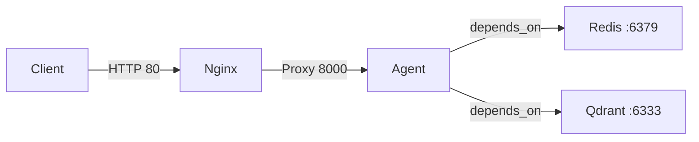

# Day 14 Lab - Mission Answers

## Part 1: Localhost vs Production

### Exercise 1.1: Anti-patterns found

1. **Ghi cứng thông tin xác thực.** API key và mật khẩu trong chuỗi kết nối có thể bị lộ qua repo hoặc lịch sử Git. [Dòng 17–18](01-localhost-vs-production/develop/app.py#L17-L18)
2. **Ghi dữ liệu nhạy cảm vào log.** Log lưu cả API key, câu hỏi và câu trả lời, nên người đọc log có thể thấy dữ liệu này. [Dòng 33–38](01-localhost-vs-production/develop/app.py#L33-L38)
3. **Thiếu health check.** Ứng dụng thiếu endpoint `/health` để nền tảng kiểm tra tiến trình còn hoạt động. [Dòng 42–43](01-localhost-vs-production/develop/app.py#L42-L43)
4. **Chỉ lắng nghe trên `localhost`.** Kết nối từ ngoài container không đến được địa chỉ loopback của ứng dụng. [Dòng 51](01-localhost-vs-production/develop/app.py#L51)
5. **Cố định cổng `8000`.** Ứng dụng bỏ qua cổng `PORT` do nền tảng cấp. [Dòng 52](01-localhost-vs-production/develop/app.py#L52)
6. **Luôn bật `reload`.** Uvicorn theo dõi mã nguồn và có thể khởi động lại worker khi file thay đổi. [Dòng 53](01-localhost-vs-production/develop/app.py#L53)

### Exercise 1.2: Run the develop version

Môi trường kiểm tra dùng Python 3.12.3 và mock LLM. Bản develop chạy bằng `python app.py` trong `01-localhost-vs-production/develop/` và nhận `question` qua query string.

```bash
curl -i -X POST 'http://localhost:8000/ask?question=Hello'
```

Kết quả trả về **HTTP 200**.

```json
{"answer":"Agent đang hoạt động tốt! (mock response) Hỏi thêm câu hỏi đi nhé."}
```

`GET /health` trả **HTTP 404** với `{"detail":"Not Found"}`.

### Exercise 1.3: Comparison table

| Feature | Develop | Production | Why Important? |
| --- | --- | --- | --- |
| Config | Ghi cứng key, host, port và chế độ reload. | Đọc cấu hình từ biến môi trường. `PORT` được đọc ở [`config.py:18`](01-localhost-vs-production/production/config.py#L18) và truyền vào Uvicorn ở [`app.py:197`](01-localhost-vs-production/production/app.py#L197). | Dùng cùng mã nguồn cho nhiều môi trường và cấp secret lúc chạy. |
| Health check | Thiếu `/health` và `/ready`. | `/health` kiểm tra liveness. `/ready` trả `503` khi cờ sẵn sàng chưa bật. [`app.py:135–161`](01-localhost-vs-production/production/app.py#L135-L161) | Nền tảng biết tiến trình còn sống và có thể nhận traffic hay chưa. |
| Logging | `print()` in cả nội dung request và API key. | `logging` ghi tên sự kiện và độ dài câu hỏi, câu trả lời. [`app.py:110–122`](01-localhost-vs-production/production/app.py#L110-L122) | Dễ tìm sự kiện và giảm dữ liệu nhạy cảm trong log. |
| Shutdown | Thiếu bước dọn dẹp ở cấp ứng dụng. | `lifespan` bật cờ sẵn sàng khi khởi động và hạ cờ khi tắt. [`app.py:39–74`](01-localhost-vs-production/production/app.py#L39-L74) | Có điểm dọn tài nguyên khi triển khai lại hoặc tắt instance. |

**Kết quả kiểm tra bản production**

`GET /health` trả **200** với `status=ok`, `GET /ready` trả **200** với `ready=true`, và `POST /ask` với `{"question":"Hello"}` trả **200** kèm câu trả lời mock. Khi dừng bằng `Ctrl+C`, Uvicorn ghi `Application shutdown complete.`

Trong lần chạy mock, cảnh báo từ `config.py` tạo handler log trước khi `app.py` gọi `logging.basicConfig`. Vì vậy, log thực tế dùng định dạng mặc định, với dòng cảnh báo bắt đầu bằng `WARNING:root`.

## Part 2: Docker

### Exercise 2.1: Dockerfile questions

1. **Base image.** `python:3.11` cung cấp môi trường Python cho container. [Dòng 8](02-docker/develop/Dockerfile#L8)
2. **Working directory.** `WORKDIR /app` đặt thư mục làm việc bên trong container. [Dòng 11](02-docker/develop/Dockerfile#L11)
3. **Thứ tự `COPY`.** Copy `requirements.txt` và cài dependency trước khi copy mã nguồn để Docker có thể dùng lại layer cài đặt khi danh sách dependency giữ nguyên. [Dòng 13–20](02-docker/develop/Dockerfile#L13-L20)
4. **`CMD` và `ENTRYPOINT`.** `ENTRYPOINT` chỉ định chương trình chính. `CMD` cung cấp lệnh mặc định hoặc đối số mặc định cho `ENTRYPOINT`. Dockerfile mẫu dùng `CMD ["python", "app.py"]`. [Dòng 30](02-docker/develop/Dockerfile#L30)

### Exercise 2.2: Build and run

Image `my-agent:develop` được build từ thư mục gốc repo. Container ánh xạ cổng `8000` và nhận câu hỏi qua query string.

```bash
curl -i -X POST 'http://localhost:8000/ask?question=Hello'
```

```text
HTTP/1.1 200 OK
server: uvicorn
content-type: application/json
```

### Exercise 2.3: Image size comparison

Kích thước hiển thị trong `docker images` sau khi build hai image.

- **Develop** — `my-agent:develop` có kích thước **1,67 GB** (khoảng **1.670 MB**).
- **Production** — `my-agent:advanced` có kích thước **240 MB**.
- **Difference** — giảm khoảng **85,6%**, tính theo `(1670 - 240) / 1670 × 100%`.

Stage `builder` cài công cụ build và dependency Python. Stage `runtime` dùng base `python:3.11-slim` và lấy dependency đã cài cùng mã cần để chạy. Kích thước giảm nhờ base nhẹ hơn và các công cụ như `gcc`, `libpq-dev` chỉ nằm ở stage build. [Dockerfile production](02-docker/production/Dockerfile#L12-L52)

### Exercise 2.4: Docker Compose stack



Nginx nhận HTTP ở cổng `80` và chuyển request đến `agent:8000`. Compose khởi động Agent khi Redis và Qdrant đạt health check. Hai nhánh `depends_on` thể hiện điều kiện khởi động. Endpoint `/ask` dùng mock LLM. [Compose](02-docker/production/docker-compose.yml#L22-L47) · [Nginx](02-docker/production/nginx/nginx.conf#L14-L28) · [Handler `/ask`](02-docker/production/main.py#L57-L64)

`docker compose ps` ghi nhận Agent, Redis và Qdrant ở trạng thái `healthy`, còn Nginx ở trạng thái `Up` và công bố cổng `80`.

| Request qua `localhost:80` | Phản hồi |
| --- | --- |
| `GET /health` | `200 OK`, `Server: nginx`, `status=ok`, `version=2.0.0`. |
| `POST /ask` với `{"question":"Explain microservices"}` | `200 OK`, `Server: nginx`, trường `answer` chứa câu trả lời mock. |

## Part 3: Cloud Deployment

### Exercise 3.2: Render deployment

Triển khai agent Part 6 qua Blueprint [`06-lab-complete/render.yaml`](06-lab-complete/render.yaml). Cấu hình khai báo Web Service `day14-agent` chạy bằng Docker và Key Value `day14-redis`, cùng dùng gói Free tại Singapore. `REDIS_URL` tham chiếu kết nối nội bộ của Key Value; `AGENT_API_KEY` được nhập trên Render.

URL public: **https://day14-agent-c14l.onrender.com**. Kiểm thử HTTPS ngày 26/11/2026 đạt đủ bốn trường hợp yêu cầu ở CP6. Lệnh chạy, thời điểm và kết quả được tổng hợp trong [`DEPLOYMENT.md`](DEPLOYMENT.md).

| Phép thử | Yêu cầu | Kết quả thực tế |
| --- | --- | --- |
| `GET /health` | `200` | `200`, `{"status":"ok"}`. |
| `GET /ready` | `200` | `200`, `{"ready":true}`. |
| `POST /ask`, thiếu key | `401` | `401`, `Missing or invalid API key`. |
| `POST /ask`, đúng key | `200` | `200`, JSON có `question: "Hello"` và `answer` chứa câu trả lời mock. |

Ảnh bằng chứng: [Dashboard](screenshots/dashboard.png) · [Agent Live](screenshots/running.png) · [Kiểm thử API](screenshots/test.png).

### Exercise 3.1–3.2: Configuration comparison

| Nội dung | `railway.toml` | `render.yaml` |
| --- | --- | --- |
| Định dạng | TOML. | YAML. |
| Build Agent | Chọn builder `DOCKERFILE`. | Chọn `runtime: docker`, root directory `06-lab-complete` và `./Dockerfile`. |
| Health check | `healthcheckPath = "/health"`. | `healthCheckPath: /health`. |
| Redis | File hiện tại không khai báo Redis; cần tạo service và đặt biến kết nối trên nền tảng. | Blueprint khai báo Key Value và truyền `REDIS_URL` qua `fromService` với `property: connectionString`. |
| API key | Đặt bằng biến môi trường trên nền tảng. | `sync: false` yêu cầu nhập giá trị khi tạo Blueprint. |
| Phạm vi cấu hình | Build và health check của Agent. | Agent, Key Value, vùng Singapore, gói Free và các biến môi trường. |

Hai cấu hình đều sử dụng Dockerfile và endpoint `/health`. Blueprint Render mô tả thêm các tài nguyên và liên kết giữa chúng, giúp triển khai Agent cùng Redis từ một file. Cấu hình Railway được giữ để đối chiếu; nền tảng triển khai chính là Render. [Railway](06-lab-complete/railway.toml) · [Render](06-lab-complete/render.yaml)

### Exercise 3.3: Cloud Run pipeline

1. `cloudbuild.yaml` bắt đầu bằng cài dependency và chạy `pytest tests/`.
2. Bước build tạo Docker image với tag `$COMMIT_SHA` và `latest`, sau đó bước push đưa image lên registry.
3. Bước deploy dùng image theo commit để triển khai Cloud Run tại `asia-southeast1`, kèm cấu hình tài nguyên, scaling và tham chiếu secret.
4. `service.yaml` mô tả service với cổng `8000`, concurrency `80`, giới hạn instance, tài nguyên, biến môi trường và probes `/health`, `/ready`.

[Pipeline](03-cloud-deployment/production-cloud-run/cloudbuild.yaml) · [Service definition](03-cloud-deployment/production-cloud-run/service.yaml)

## Part 4: API Security

### Exercise 4.1-4.3: Test results

**4.1 — API key authentication**

`POST /ask` gọi `verify_api_key` để đọc `X-API-Key` và so sánh với `AGENT_API_KEY`. Thiếu header trả `401`, key sai trả `403`, key hợp lệ trả `200`. Để đổi key, cập nhật biến môi trường, khởi động lại app và chuyển client sang key mới. [Code kiểm tra key](04-api-gateway/develop/app.py#L35-L54) · [Endpoint `/ask`](04-api-gateway/develop/app.py#L67-L79)

Trích đoạn phản hồi `curl -i` khi lần lượt gửi request thiếu key, key sai và key hợp lệ.

```http
HTTP/1.1 401 Unauthorized
server: uvicorn
content-type: application/json

HTTP/1.1 403 Forbidden
server: uvicorn
content-type: application/json

HTTP/1.1 200 OK
server: uvicorn
content-type: application/json
```

**4.2 — JWT authentication**

`POST /auth/token` cấp token Bearer có hiệu lực 60 phút cho tài khoản demo `student`. JWT có thông tin định danh, vai trò và thời điểm hết hạn, được ký bằng HS256. App xác thực chữ ký và hạn dùng của token trong header `Authorization`. Sau vòng lặp `/ask`, truy vấn `GET /me/usage` bằng cùng token trả `200`. [Endpoint cấp token](04-api-gateway/production/app.py#L105-L118) · [Ký và xác thực JWT](04-api-gateway/production/auth.py#L22-L67)

**4.3 — Rate limiting**

Limiter dùng sliding window 60 giây theo từng user và lưu timestamp trong RAM. Mỗi lần gọi, app bỏ các timestamp đã ra khỏi cửa sổ rồi đếm số request còn lại. Role `user` có hạn mức 10 request/phút và role `admin` dùng limiter riêng với hạn mức 100 request/phút. [Thuật toán và hạn mức](04-api-gateway/production/rate_limiter.py#L24-L71) · [Cấu hình hai limiter](04-api-gateway/production/rate_limiter.py#L85-L87) · [Chọn limiter theo role](04-api-gateway/production/app.py#L137-L142)

Vòng lặp gửi 20 request liên tiếp bằng token của `student`. Trích đoạn `curl -i` của request thứ 20 cho thấy quota đã hết và thời gian chờ là 59 giây.

```http
HTTP/1.1 429 Too Many Requests
server: uvicorn
x-ratelimit-limit: 10
x-ratelimit-remaining: 0
retry-after: 59
content-type: application/json
```

### Exercise 4.4: Cost guard implementation

- **Mẫu hiện tại.** App kiểm tra chi phí đã dùng trước khi gọi LLM và ghi nhận chi phí theo số token đầu vào, đầu ra sau khi có kết quả. Usage theo user và ngày được giữ trong RAM. Khi user chạm mức 1 USD/ngày, app trả `402`. Khi tổng chi phí chạm ngưỡng 10 USD, app trả `503`. [Luồng `/ask`](04-api-gateway/production/app.py#L144-L153) · [Cost guard](04-api-gateway/production/cost_guard.py#L39-L110)
- **Thiết kế Redis cho hạn mức tháng.** Dùng key `budget:{user_id}:{YYYY-MM}` để lưu chi phí theo user, với hạn mức 10 USD/tháng. Trước khi gọi LLM, kiểm tra và giữ chỗ chi phí ước tính bằng một thao tác nguyên tử. Sau khi có kết quả, đối soát theo số token và hoàn phần giữ chỗ còn dư. Sang tháng mới dùng key mới, đặt TTL để dọn key cũ.
- **Kết quả kiểm tra.** Sau vòng lặp, `GET /me/usage` ghi nhận 10 request đã xử lý, 60 token đầu vào, 300 token đầu ra và chi phí mock `0.000189` USD. Trong phép thử đối chiếu cô lập, ghi nhận số token giả lập tương ứng 1,20 USD vào `CostGuard` khiến lần kiểm tra tiếp theo trả `402`.

Rate limit kiểm soát tần suất gọi. Cost guard kiểm soát tổng tiền vì các request có thể dùng số token khác nhau dù có cùng tần suất.

## Part 5: Scaling & Reliability

### Exercise 5.1-5.5: Implementation notes

**5.1 — Health checks**

`/health` kiểm tra liveness, tức tiến trình còn hoạt động. `/ready` kiểm tra app đã sẵn sàng nhận request mới và trả `503` khi cờ sẵn sàng chưa bật. Trong lượt chạy bản develop, `/health` trả `200` với `status=ok` và uptime `16.9` giây. `/ready` trả `200` với `ready=true`. [Hai endpoint health check](05-scaling-reliability/develop/app.py#L104-L168)

**5.2 — Graceful shutdown**

Chạy bản develop bằng `python app.py`. Gửi `SIGTERM` tới PID `16769` khoảng 0,5 giây sau khi bắt đầu `POST /ask?question=hello`. Log ghi nhận Uvicorn bắt đầu shutdown, request đang chạy trả `HTTP/1.1 200 OK`, sau đó tiến trình kết thúc. Phần shutdown của `lifespan` hạ cờ readiness. [Lifespan](05-scaling-reliability/develop/app.py#L41-L66) · [Xử lý tín hiệu](05-scaling-reliability/develop/app.py#L175-L199)

```text
INFO:     Shutting down
INFO:     127.0.0.1:49820 - "POST /ask?question=hello HTTP/1.1" 200 OK
2026-11-26 16:25:07,017 INFO 🔄 Graceful shutdown initiated...
INFO:     Application shutdown complete.
INFO:     Finished server process [16769]
```

**5.3 — Stateless design**

Mỗi instance có RAM riêng, nên lịch sử giữ trong RAM của instance A sẽ không có sẵn khi request kế tiếp đến instance B. Mẫu production lưu session trong Redis bằng key `session:{session_id}` với TTL 3.600 giây. Client gửi lại cùng `session_id`, và bất kỳ Agent nào cũng có thể đọc hoặc cập nhật lịch sử đó. [Lưu và đọc session](05-scaling-reliability/production/app.py#L59-L89)

**5.4 — Load balancing**

Stack `k5-day14-scaling` chạy với `--scale agent=3`. `docker compose ps` ghi nhận cả ba Agent và Redis ở trạng thái `healthy`. Nginx ở trạng thái `Up`, nhận request trên cổng host `8080` và chuyển đến các Agent ở cổng nội bộ `8000`. [Compose](05-scaling-reliability/production/docker-compose.yml#L18-L46) · [Nginx upstream](05-scaling-reliability/production/nginx.conf#L7-L24)

**5.5 — Test stateless**

Chạy `python test_stateless.py` qua Nginx ở `localhost:8080`. Cả ba Agent xử lý các lượt khác nhau trong cùng một session. Truy vấn lịch sử trả đủ 5 câu hỏi và 5 câu trả lời theo thứ tự, cho thấy các Agent đọc và ghi cùng dữ liệu session trong Redis. [Script kiểm tra](05-scaling-reliability/production/test_stateless.py#L49-L82)

```text
Total requests: 5
Instances used: {'instance-52790e', 'instance-6dc179', 'instance-a2ff1f'}
Total messages: 10
```

Khi dừng một Agent, instance còn lại vẫn đọc được đủ 10 message từ Redis. Với upstream tĩnh `server agent:8000` trong cấu hình Nginx mẫu, truy vấn qua proxy chưa hoàn tất trong thời hạn kiểm tra. Sau khi reload Nginx, request trả `200` và lịch sử cùng session tăng lên 12 message. Kết quả xác nhận state được giữ độc lập với instance; cấu hình proxy mẫu còn hạn chế khi cập nhật các đích upstream.

## Part 6: Final Project

### Implementation notes

- **Cấu hình và health check.** App đọc cấu hình từ biến môi trường được liệt kê trong `.env.example`. `/health` trả `200` khi tiến trình đang chạy. `/ready` kiểm tra Redis với thời hạn kết nối và trả `503` khi Redis mất kết nối. [Config](06-lab-complete/app/config.py) · [Mẫu biến môi trường](06-lab-complete/.env.example) · [Redis client](06-lab-complete/app/redis_client.py)
- **Xác thực và giới hạn.** `/ask` trả `401` khi thiếu hoặc sai `X-API-Key`. Rate limiter dùng sorted set và script nguyên tử trong Redis để các worker chia sẻ cửa sổ 60 giây. Script chấm xác nhận Agent vẫn trả `429` sau khi restart vì trạng thái quota còn trong Redis. [Auth](06-lab-complete/app/auth.py) · [Rate limiter](06-lab-complete/app/rate_limiter.py)
- **Cost guard.** App dùng ngân sách chung 1 USD/ngày UTC, cấu hình qua `DAILY_BUDGET_USD`. Trước mỗi lượt, app đọc tổng chi phí đã ghi nhận và trả `402` khi chạm ngưỡng. Sau khi mock LLM hoàn tất, app ước tính hai token cho mỗi từ và cộng chi phí vào Redis. [Cost guard](06-lab-complete/app/cost_guard.py) · [Luồng `/ask`](06-lab-complete/app/main.py#L96-L103)
- **Log và shutdown.** App ghi mỗi sự kiện dưới dạng một JSON object. Uvicorn hoàn tất request đang chạy khi nhận `SIGTERM`, rồi lifespan đóng Redis. Docker chạy Uvicorn ở PID 1 bằng `exec`. [Lifespan](06-lab-complete/app/main.py) · [Dockerfile](06-lab-complete/Dockerfile)
- **Đóng gói.** Image multi-stage dùng base slim và chạy non-root. `.dockerignore` loại secret, cache và virtualenv khỏi build context. Compose khởi động Agent cùng Redis. Dockerfile đọc `PORT`; Blueprint Render khai báo Agent, Key Value và health check `/health`. URL public được kiểm tra ở CP6. [Dockerfile](06-lab-complete/Dockerfile) · [Docker ignore](06-lab-complete/.dockerignore) · [Compose](06-lab-complete/docker-compose.yml) · [Render](06-lab-complete/render.yaml)

### Manual test results

Chạy Compose với project `k5-day14-cp5`. Cả Agent và Redis đạt trạng thái `healthy`. Kết quả kiểm tra qua `localhost:8000` như sau.

| Trường hợp | Kết quả |
| --- | --- |
| `GET /health`, `GET /ready` khi Redis hoạt động | Cùng trả `200`, lần lượt có `status=ok` và `ready=true`. |
| `POST /ask` thiếu key hoặc key sai | `401`, `Missing or invalid API key`. |
| Key hợp lệ, `question` rỗng | `422`, lỗi độ dài trường `question`. |
| Key hợp lệ, câu hỏi về deployment | `200`, JSON có `question` và `answer`. |
| Một request hợp lệ trước vòng lặp, rồi gửi thêm 12 request | Thêm 9 lượt trả `200`, sau đó 3 lượt trả `429` với `Retry-After: 48`, đúng quota 10 lượt/60 giây. |
| Dừng Redis rồi gọi hai health endpoint | `/health` trả `200`, `/ready` trả `503` với `Redis unavailable`. |

Log request của ứng dụng ghi các trường `ts`, `lvl`, `event`, `method`, `path`, `status` và `ms` dưới dạng JSON. Log truy cập của Uvicorn xuất hiện ở dòng riêng theo định dạng của server.

### Checklist Deliverable

Kiểm tra tại CP5 bằng `python check_production_ready.py` trong `06-lab-complete/` với Docker đạt **PASS 12/12**. Script đo image **273 MB** và `docker stop` thoát mã `0` sau **0,9 giây**.

```text
================================================================
  📋 Checklist Deliverable
     ✅ Dockerfile (multi-stage, < 500 MB)
     ✅ docker-compose.yml (agent + redis)
     ✅ .dockerignore
     ✅ Health check endpoint (GET /health)
     ✅ Readiness endpoint (GET /ready)
     ✅ API Key authentication
     ✅ Rate limiting
     ✅ Cost guard
     ✅ Config từ environment variables
     ✅ Structured logging
     ✅ Graceful shutdown
     ✅ Public URL ready (Railway / Render config)
----------------------------------------------------------------
  Result: 12/12 tiêu chí đạt · 41/41 checks passed
  🎉 PASS 12/12 — PRODUCTION READY! Deploy nào!
================================================================
```

## Part 7: Benchmark & Observability

### Exercise 7.1: Metrics

Sau một request `POST /ask` thành công, endpoint `/metrics` ghi nhận:

| Loại | Metric | Quan sát |
| --- | --- | --- |
| Counter | `http_requests_total` | Series `method="POST",route="/ask",status="200"` có giá trị `1`. |
| Gauge | `agent_in_flight_requests` | Giá trị `0` sau khi request hoàn tất. |
| Histogram | `agent_question_length_chars` | `_count = 1`, `_sum = 40`. Bucket `le="20.0"` có giá trị `0` và `le="50.0"` có giá trị `1`. |

Nếu dùng URL thực làm label, mỗi đường dẫn lạ có thể tạo một time series riêng cho counter và nhiều series cho histogram. Số series tăng theo số đường dẫn, làm tăng chi phí lưu trữ và truy vấn. Dùng route template và gom các đường dẫn không khớp vào `unmatched` giúp giữ số giá trị label ổn định.

Histogram ghi độ dài câu hỏi tại `/ask` sau khi payload hợp lệ, với các bucket cố định từ 20 đến 2.000 ký tự. [Mã nguồn metrics](06-lab-complete/benchmark-observability/develop/app.py)

### Exercise 7.2–7.3: Benchmark local

Số liệu tải, phân tích SLO, kết quả eval và cách cấu hình quality gate được trình bày trong [BENCHMARK_REPORT.md](BENCHMARK_REPORT.md).

## AI log

- **CP1** — Học viên thực hành CP1 trước khi dùng AI. Codex hỗ trợ rà tiêu chí K5, đối chiếu các dòng code minh họa anti-pattern và biên tập bảng so sánh. Trích đoạn HTTP trong báo cáo lấy từ lượt Codex chạy lại hai app mẫu để đối chiếu.
- **CP2** — Học viên build và đo kích thước hai image, chạy Compose và kiểm tra `/health` cùng `/ask` qua Nginx. Codex hỗ trợ đọc Dockerfile và Compose, hướng dẫn vận hành stack và biên tập Part 2 dựa trên kết quả học viên cung cấp.
- **CP3** — Học viên kiểm tra API key, lấy JWT, chạy vòng lặp để quan sát `429` và xem kết quả `/me/usage`. Codex hỗ trợ giải thích các câu hỏi, chạy đối chiếu riêng và biên tập Part 4 từ kết quả học viên cung cấp. Lượt đối chiếu có kiểm tra nhánh `402` bằng số token LLM giả lập.
- **CP4** — Học viên chạy health check, gửi `SIGTERM` khi request đang xử lý, bật stack ba Agent và kiểm tra lịch sử bằng `test_stateless.py`. Codex hỗ trợ đọc mã mẫu, giải thích kết quả và biên tập Part 5 từ output học viên cung cấp. Phép thử dừng một Agent được thực hiện trong lượt đối chiếu riêng của Codex.
- **CP5** — Học viên triển khai Part 6 từ bản khung với sự hỗ trợ của Codex về code và cấu hình theo từng tiêu chí lab. Học viên trực tiếp chạy Compose, kiểm tra health/readiness, API key, input rỗng, rate limit, log JSON và trạng thái khi dừng Redis, sau đó chạy script chấm đầy đủ xác nhận `PASS 12/12`. Codex hỗ trợ giải thích luồng xử lý, chạy đối chiếu và biên tập Part 6 từ kết quả thực hành.
- **CP6** — Học viên tạo tài khoản Render, thiết lập API key, triển khai Blueprint từ repo đã push, kiểm thử `/ask` có key và chụp ba ảnh bằng chứng. Request trả `HTTP 200` cùng câu trả lời mock. Codex hỗ trợ cấu hình Blueprint, giải thích kết nối Agent/Redis, chạy đối chiếu endpoint và script chấm sau deploy, rà ảnh và biên tập kết quả cùng phần so sánh cấu hình, pipeline Cloud Run. API key được nhập và giữ trên máy học viên.
- **CP7** — Học viên hoàn thiện bài thực hành đo tải và đánh giá v1/v2 theo lộ trình K5. Hai câu eval chưa đạt là căn cứ để bổ sung kiến thức về JWT và Kubernetes HPA. Lượt kiểm tra lại đạt 23/23, không có regression. Codex hỗ trợ bổ sung histogram và nội dung kiến thức, chạy các script local và đối chiếu số liệu trong báo cáo với JSON gốc.
